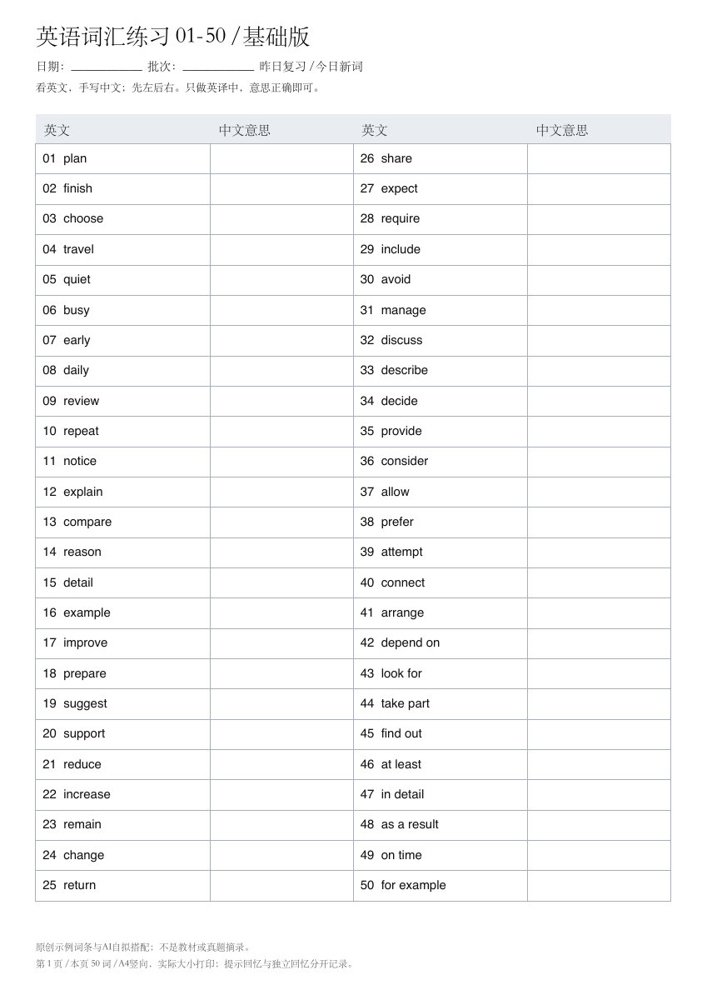

# IELTS Coach · 雅思 AI 备考 Skill

把「练习 → 解释错误 → 自己重做 → 保存复盘 → 下次复测」串起来，覆盖词汇、阅读、听力、写作和口语。

这是一套给 AI 使用的训练流程与模板。它可以按需求直接改一篇作文、分析一道错题，也可以陪你制定计划、持续练习。需要你自己准备合法取得的教材、题目和音频。

**快速下载：** [Skill 安装包](https://github.com/xiaolu-ai26/ielts-coach/releases/latest/download/ielts-coach.zip) · [查看入口](SKILL.md) · [原创示例](references/worked-examples.md)

## 能帮你做什么

| 模块 | 做法 | 结果 |
|---|---|---|
| 词汇 | 沿用单词书顺序，先复习昨天的词，再学新词；AI解释错义与搭配 | 基础版、AI提示版四列A4；看英文，手写中文 |
| 阅读 | 先分析错题，再询问做对但不确定的题；核对答案和原文证据 | 原句内括号拆语法、选项排除、无答案复测材料 |
| 听力 | 先独立听，再核答案；卡住的片段反复听，对原文后关掉文本再听 | 简短词句解释与针对性复听记录 |
| 写作 | 审题/看图、提纲/overview、原稿批改、自己写二稿 | 按原句证据反馈，保留初稿和待复测问题 |
| 口语 | 准备自己的素材与观点，Part 1/2/3分开练；教练/模考两种模式 | GPT或豆包可复制语音指令、原话纠错、脱稿重答、口语错题稿 |
| 计划与复盘 | 根据目标、实际材料和表现安排；练完主动询问是否保存 | 各科独立记录、跨会话续接、延后复测 |

## 安装

### 已有支持本地 Skills 的 AI 环境

下载上面的安装包并解压，把 `ielts-coach` 文件夹放进该工具的用户 Skills 目录；保留 `SKILL.md`、`references/`、`assets/`、`scripts/` 的相对位置。按客户端要求重新加载后，调用 `ielts-coach`。

Codex 常用目录可直接克隆（目标文件夹不存在时）：

```bash
git clone https://github.com/xiaolu-ai26/ielts-coach.git ~/.codex/skills/ielts-coach
```

如果已经装过，先保存自己的改动再更新；不要用上面的命令覆盖现有目录。其他工具的目录以其文档为准。

### 只使用 ChatGPT 或豆包聊天/语音

无需假设它能安装本地 Skill。可以复制[语音交接规则](references/voice-handoff.md)，或直接用已经填好的[口语练习示例](examples/voice-practice.md)。先发到文字聊天，再进入客户端实际可用的语音交流入口，确认对方收到题卡和练习规则。

本地文件、PDF脚本和学习记录不会自动同步到另一个App。练后把转写或复盘摘要带回来，才能接着用。

## 直接开始

不必为了改一道题先填完档案；把完整材料和本轮任务一起给AI即可。

**阅读错题：**

> 使用ielts-coach。这里有阅读原文、完整题目、我的原答和答案页。先处理错题，核对答案依据。语法请在完整原句里加括号解释，不按主谓宾拆成多行；讲完让我收起解析，自己说为什么选这个答案。错题完成后，再问我有没有蒙对或不确定的题。

**写作：**

> 使用ielts-coach。这是完整Task 2题目和我的初稿。先检查是否答齐问题、论点是否展开，再处理词汇语法。引用我的原句，给最小修改及原因，先让我自己写二稿，不要直接整篇代写。结束时询问是否保存复盘和准备下次复测。

**口语：**

> 使用ielts-coach，准备一份能复制到GPT或豆包语音中的旅行话题练习指令。教练模式，一题一答，答完只改最重要的两点，让我脱稿重答，再换问法。只根据真实原话反馈，只有转写时不评发音。练完主动询问是否输出口语错题稿。

**词汇：**

> 使用ielts-coach，按我提供的单词书编号选今天的50个主词，生成基础版和AI提示版A4。四列是英文、中文留空、英文、中文留空。两版词序一致，提示版只补简短英文语境，不放中文答案。明天先复习今天这批词。

## 打印词汇表

仓库提供原创示例和两个现成模板：

- [基础版PDF](assets/vocabulary-paper-template.pdf)
- [AI提示版PDF](assets/vocabulary-paper-hints.pdf)
- [50词示例输入](examples/vocabulary-50.json)




需要AI生成新词表时，宿主必须能读材料、执行Python并保存文件。也可以自己运行：

```bash
python3 -m venv .venv
source .venv/bin/activate
python3 -m pip install -r requirements.txt
python3 scripts/make_vocab_sheets.py \
  --input examples/vocabulary-50.json \
  --output-dir outputs/vocabulary
```

输出 `vocabulary-basic.pdf` 和 `vocabulary-hints.pdf`。每50词一页；同一输出目录中的同名文件会被替换，请使用本次练习专用目录。安装Python依赖仅用于生成PDF；阅读Skill与复制语音指令不依赖这一步。

## 学习记录放在哪里

持续练习默认使用当前工作区里的 `ielts-study/`，不把个人成绩、作文、录音写进Skill安装目录。复盘模板在[学习档案](assets/study-record.md)、[阅读复盘](assets/reading-review-template.md)、[口语错题稿](assets/speaking-review-template.md)。

本仓库中的示例都是虚构教学示例，不是你的作答。重做需要看过提示就照实记，未作答保持待测。不同日期的零散四科练习不能拼成一套完整模考成绩。

## 能力边界

- AI估分是练习参考，不是官方考试成绩；本项目不保分，也不提供自建英语等级测评。
- 没有实际声音证据，不评价发音、重音、语速或真实流利度。
- 精确计时、播放、录音分析、文件生成和保存取决于宿主工具；纯文字环境可以分析已有文本。
- 第三方口语题库可以用于准备，但不是官方固定必考清单。
- 跨平台语音指令已完成文本流程设计，真实语音效果取决于当前客户端，需要实际练习验证。

## 文件结构

```text
SKILL.md          AI入口与按需路由
references/       各科训练、题型、语音交接和复盘规则
assets/           纸面模板与学习记录模板
scripts/          A4词汇表生成脚本
examples/         原创示例输入、语音练习和打印预览
```

## 来源、许可与反馈

- [官方资料与开源项目借鉴](references/sources.md)
- [用户提供的B站视频及方法取舍](references/video-methods.md)
- [第三方资料说明](THIRD_PARTY.md)

代码、训练规则及本仓库原创模板采用[MIT许可证](LICENSE)。本项目与IELTS、Cambridge、OpenAI、豆包或雅思哥无官方关联。链接到外部内容不改变原作者的权利；仓库不打包教材、真题库、录音或付费课程。

发现问题可[提Issue](https://github.com/xiaolu-ai26/ielts-coach/issues)。请用自拟例句或必要的短片段描述问题，不要上传账号凭据、私人学习档案或整本教材。
